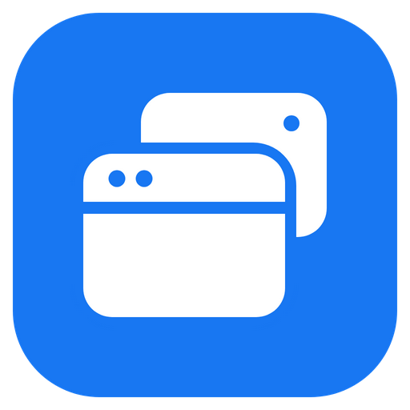
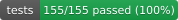
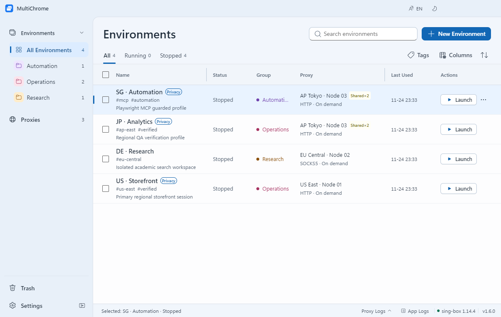

<div align="center">



# MultiChrome

A local-first, cross-platform desktop manager for isolated browser profiles.

[](https://github.com/OliverWalker1122/multichrome/actions/workflows/ci.yml)
[](https://github.com/OliverWalker1122/multichrome/actions/workflows/release.yml)
[](https://github.com/OliverWalker1122/multichrome/actions/workflows/ci.yml)
[](https://github.com/OliverWalker1122/multichrome/releases)
[](https://github.com/OliverWalker1122/multichrome)
[](https://opensource.org/licenses/MIT)

English · [简体中文](README_ZH.md)

</div>

---

## Overview

MultiChrome is a desktop application built with Electron and Fluent UI for isolating and managing multiple browser profiles, proxy configurations, and runtime environments on a single machine. All profiles, settings, and credentials stay 100% local with no cloud dependency. The interface defaults to English and supports instant switching to Simplified Chinese.

<p align="center">
  <picture>
    <source media="(prefers-color-scheme: dark)" srcset="docs/images/overview-dark.png" />
    
  </picture>
</p>

## Features

- **Dual Browser Engines**: Choose between official Google Chrome or an on-demand open-source `fingerprint-chromium` C++ privacy kernel per profile, running in pure native zero-extension, zero-JS-hook stealth mode by default.
- **Isolated Proxy Management & IP Rotation**: Managed `sing-box` routing supporting `http`/`https`/`socks5` plus `vless://`, `vmess://`, `trojan://`, `ss://`, `hy2://`, `hysteria2://`, and `tuic://` share URIs and batch import; single-flight HTTPS geo exit probing, encrypted rotation webhook URLs (`Rotate IP` with automatic exit re-probe), cross-profile reuse warnings, readable REALITY/TLS error diagnostics, automatic tunnel recycling, and strict fail-closed leak protection.
- **Environment Consistency & Native Session Tools**: Automatic alignment for timezone, language, and geolocation based on proxy exit region, pre-launch consistency guards, one-click health inspection, extensionless CDP Cookie Import & Export (JSON & Netscape), and one-click running window grid tiling.
- **Batch Productivity & Encrypted Offline Migration**: Bulk-create up to 50 numbered profiles with unique fingerprint seeds and sequential proxy assignment; multi-select batch actions (Launch, Stop, Move Group, Assign Proxy, Add Tags, Trash); password-encrypted `.mcbackup` export/restore (`scrypt + AES-256-GCM`); 30-day trash recovery; live memory telemetry; and cache cleanup.
- **Standard CDP Guard & MCP Integration**: Opt-in local `127.0.0.1` guarded CDP endpoint (default port `18922`, `Host` allowlist + browser `Origin` rejection against DNS rebinding) and a minimal 4-tool profile MCP server (Streamable HTTP `/mcp` + `stdio` bridge), 100% compatible with `@playwright/mcp`, `chrome-devtools-mcp`, Playwright, and Puppeteer while silently absorbing external UA, timezone, locale, or viewport overrides, blocking accidental incognito contexts, and closing CDP if the bound proxy drops.
- **Zero-Telemetry Verification & Bilingual UX**: Credentials encrypted via OS secure storage, sanitized JSON diagnostics export, SHA-256 verified in-app installer downloads, live outbound host audit logs, English by default with one-click Chinese (`简体中文`) switching, and Windows / macOS / Linux support.

## Installation

Download the installer for your platform from [GitHub Releases](https://github.com/OliverWalker1122/multichrome/releases). The app bundles its runtime and requires no extra frameworks.

> First-launch note: Releases are not commercially code-signed. On Windows, click **More info → Run anyway** if SmartScreen appears. On macOS, allow the app in **System Settings → Privacy & Security** or run `xattr -cr /Applications/MultiChrome.app`.

Verify downloaded installers against `SHA256SUMS.txt` and GitHub SLSA build provenance attestations:

```bash
sha256sum -c SHA256SUMS.txt
gh attestation verify <downloaded-installer> --repo OliverWalker1122/multichrome
```

Optional third-party components (`sing-box` and `fingerprint-chromium`) are not bundled. You can download and verify them on demand inside **Settings → Components**, or import local builds.

To run from source:

```bash
git clone https://github.com/OliverWalker1122/multichrome.git
cd multichrome
npm install
npm run dev
```

## Local Testing & Verification

MultiChrome uses a 4-layer verification suite (see [docs/verification.md](docs/verification.md)):

- **L1 Unit & Integration Tests**: `npm test` (pure business logic, proxy URI parsing, CDP guard/MCP, architecture layering fitness, and real `sing-box` isolation tests).
- **L2 Core Security & Anti-Detection E2E**: `npm run test:e2e` (offline dual-engine fail-closed routing, WebRTC zero-leak, anti-hook `lies=0`, and startup hold-gate checks).
- **L3 UI Smoke Tests**: After `npm run build`, run `npm run test:ui` to launch Electron with an isolated temporary user data directory and verify default English startup, live Chinese switching, main pages, key dialogs, the CDP guard/MCP panel, and light/dark window materials under standard, reduced-transparency, and forced-colors settings. Append `-- --screenshots` to also save `.tmp/ui-screenshots/home-light.png` and `home-dark.png` for visual comparison.
- **L4 Live External Dual-Engine Audit (manual on demand)**: `npm run audit:live -- --proxy="<ProxyName>"` spins up isolated ephemeral profiles to separately audit both the **C++ Privacy Kernel (`fingerprint-chromium`)** and **System Chrome (`system-chrome`)** against CreepJS, BrowserScan, BrowserLeaks WebRTC, and PixelScan (also supports `--env="<ProfileName>"` and `--engine=fingerprint-chromium|system-chrome`).

## Documentation

- [Changelog](CHANGELOG.md) — Release history and new capabilities (`v1.6.0`)
- [Architecture & Design](docs/architecture.md) ([简体中文](docs/architecture_zh.md)) — Dual-engine model, fail-closed networking, supply-chain verification, and bottom-up repository layout
- [Testing & Verification](docs/verification.md) ([简体中文](docs/verification_zh.md)) — 4-layer test suite, external checker observations, and release automation
- [Development & Packaging](docs/development.md) ([简体中文](docs/development_zh.md)) — Building from source, running tests, and creating platform installers
- [Contributing Guide](CONTRIBUTING.md) — Module layering, verification gates, and privacy checklist
- [Security Policy](SECURITY.md) — Threat model and vulnerability disclosure
- [Roadmap](ROADMAP.md) ([简体中文](ROADMAP_ZH.md)) — Completed milestones and planned work

## License

Released under the [MIT License](LICENSE). Optional user-downloaded components (`sing-box`, `fingerprint-chromium`) remain subject to their respective upstream licenses.

MultiChrome is an independent open-source project and is not affiliated with, endorsed by, or sponsored by Google LLC. Google Chrome is a trademark of Google LLC.
