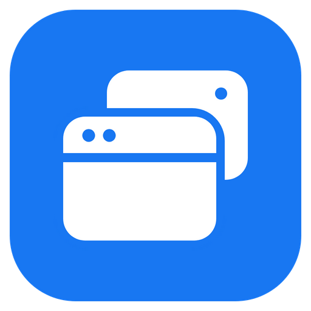

<div align="center">



# MultiChrome

A local-first, cross-platform desktop manager for isolated browser profiles.

[](https://github.com/OliverWalker1122/multichrome/actions/workflows/ci.yml)
[](https://github.com/OliverWalker1122/multichrome/actions/workflows/release.yml)
[](https://github.com/OliverWalker1122/multichrome/actions/workflows/ci.yml)
[](https://github.com/OliverWalker1122/multichrome/releases)
[](https://github.com/OliverWalker1122/multichrome)
[](https://opensource.org/licenses/MIT)

English · [简体中文](README.md)

</div>

---

## Overview

MultiChrome is a desktop application built with Electron and Fluent UI for isolating and managing multiple browser profiles, proxy configurations, and runtime environments on a single machine. All profiles, settings, and credentials stay local with no cloud dependency.

## Features

- **Dual Browser Engines**: Choose between official Google Chrome or an on-demand open-source `fingerprint-chromium` C++ privacy kernel per profile, running in pure native zero-extension, zero-JS-hook stealth mode by default.
- **Isolated Proxy Management & Multi-Protocol Import**: Managed `sing-box` routing supporting `http`/`https`/`socks5` plus `vless://`, `vmess://`, `trojan://`, `ss://`, `hy2://`, `hysteria2://`, and `tuic://` share URIs and batch import; staged geo exit probing, cross-profile reuse warnings, readable REALITY/TLS error diagnostics, automatic tunnel recycling after sleep/idle/upstream errors, and strict fail-closed leak protection.
- **Environment Consistency**: Optional automatic alignment for timezone, language, and geolocation based on proxy exit region, with pre-launch consistency guards and a one-click health inspection dialog.
- **Profile Lifecycle & Desktop Workspace**: Windows 11 Fluent 2 acrylic glass UI with colored groups and rename/delete, run-status filters, multi-tag filtering, profile cloning, 30-day trash recovery, live memory monitoring, cache cleanup, bookmark/extension templates, and per-page log dock preferences.
- **Standard CDP Guard & MCP Integration**: Opt-in local `127.0.0.1` guarded CDP endpoint (default port `18922`, `Host` allowlist + browser `Origin` rejection against DNS rebinding) and a minimal 4-tool profile MCP server (Streamable HTTP `/mcp` + `stdio` bridge), 100% compatible with `@playwright/mcp`, `chrome-devtools-mcp`, Playwright, and Puppeteer while silently absorbing external UA, timezone, locale, or viewport overrides, blocking accidental incognito contexts, and closing CDP if the bound proxy drops.
- **Local-First & Bilingual**: Credentials encrypted via OS secure storage, live outbound host audit logs, instant English / Chinese switching, and Windows / macOS / Linux support.

## Installation

Download the installer for your platform from [GitHub Releases](https://github.com/OliverWalker1122/multichrome/releases). The app bundles its runtime and requires no extra frameworks.

> First-launch note: Releases are not commercially code-signed. On Windows, click **More info → Run anyway** if SmartScreen appears. On macOS, allow the app in **System Settings → Privacy & Security** or run `xattr -cr /Applications/MultiChrome.app`.

Optional third-party components (`sing-box` and `fingerprint-chromium`) are not bundled. You can download and verify them on demand inside **Settings → Cores & Kernels**, or import local builds.

To run from source:

```bash
git clone https://github.com/OliverWalker1122/multichrome.git
cd multichrome
npm install
npm run dev
```

## Local testing & verification

MultiChrome uses a 4-layer verification suite (see [docs/verification.md](docs/verification.md)):

- **L1 Unit & Integration Tests**: `npm test` (pure business logic, proxy URI parsing, CDP guard/MCP, and real `sing-box` isolation tests).
- **L2 Core Security & Anti-Detection E2E**: `npm run test:e2e` (offline dual-engine fail-closed routing, WebRTC zero-leak, anti-hook `lies=0`, and startup hold-gate checks).
- **L3 UI Smoke Tests**: After `npm run build`, run `npm run test:ui` to launch Electron with a temporary user data directory and verify main pages, key dialogs, the CDP guard/MCP panel, and light/dark window materials under standard, reduced-transparency, and forced-colors settings. Append `-- --screenshots` to also save `.tmp/ui-screenshots/home-light.png` and `home-dark.png` for visual comparison.
- **L4 Live External Dual-Engine Audit (manual on demand)**: `npm run audit:live -- --proxy="<ProxyName>"` spins up isolated ephemeral profiles to separately audit both the **C++ Privacy Kernel (`fingerprint-chromium`)** and **System Chrome (`system-chrome`)** against CreepJS, BrowserScan, BrowserLeaks WebRTC, and PixelScan (also supports `--env="<ProfileName>"` and `--engine=fingerprint-chromium|system-chrome`).

## Documentation

- [Architecture & Design](docs/architecture.md) — Dual-engine model, fail-closed networking, supply-chain verification, and repository layout
- [Testing & Verification](docs/verification.md) — 4-layer test suite, external checker observations, and release automation
- [Development & Packaging](docs/development.md) — Building from source, running tests, and creating platform installers
- [Security Policy](SECURITY.md) — Threat model and vulnerability disclosure
- [Roadmap](ROADMAP.md) — Completed milestones and planned work

## License

Released under the [MIT License](LICENSE). Optional user-downloaded components (`sing-box`, `fingerprint-chromium`) remain subject to their respective upstream licenses.
