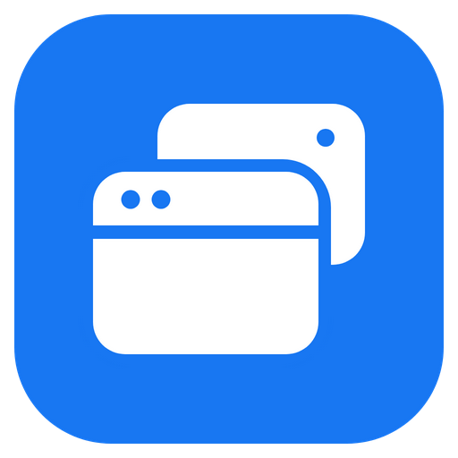
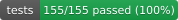
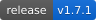
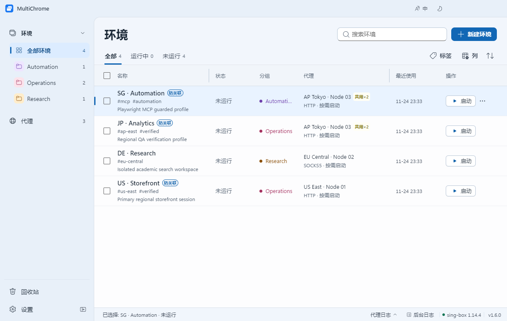

<div align="center">



# MultiChrome

本地优先的跨平台多环境浏览器管理工具。

[](https://github.com/OliverWalker1122/multichrome/actions/workflows/ci.yml)
[](https://github.com/OliverWalker1122/multichrome/actions/workflows/release.yml)
[](https://github.com/OliverWalker1122/multichrome/actions/workflows/ci.yml)
[](https://github.com/OliverWalker1122/multichrome/actions/workflows/ci.yml)
[](https://github.com/OliverWalker1122/multichrome/releases)
[](https://github.com/OliverWalker1122/multichrome)
[](https://opensource.org/licenses/MIT)

[English](README.md) · 简体中文

</div>

---

## 简介

MultiChrome 是一款基于 Electron 与 Fluent UI 构建的桌面端浏览器环境管理器，用于在一台设备上隔离并管理多个独立的浏览器配置、网络代理与运行环境。所有配置与凭据均保存在本地，不依赖云端服务。应用默认英文界面，可在顶栏或设置页一键切换为简体中文。

<p align="center">
  <picture>
    <source media="(prefers-color-scheme: dark)" srcset="docs/images/overview-dark.png" />
    
  </picture>
</p>

## 主要功能

- **双浏览器引擎支持**：支持按环境选择系统官方 Google Chrome，或按需下载的开源 `fingerprint-chromium` C++ 隐私指纹内核，默认纯原生零扩展、零 JS Hook 隐匿。
- **独立代理隔离与换 IP**：基于 `sing-box` 提供托管代理管理，支持 `http`/`https`/`socks5` 与 `vless://`、`vmess://`、`trojan://`、`ss://`、`hy2://`、`hysteria2://`、`tuic://` 分享链接及批量导入；支持加密存储换 IP Webhook 链接（一键换 IP 并自动重测出口）、单飞 HTTPS 出口测活与时区预解析、多环境复用查重提醒、REALITY/TLS 错误诊断，以及休眠恢复/异常后自动重建通道；代理异常时强制 Fail-Closed 阻断直连回退。
- **环境一致性与多窗口工作台**：支持根据代理出口自动对齐时区、语言与地理位置，提供多环境同屏启动前预检、原生零扩展 CDP Cookie 导入/导出（JSON 与 Netscape）、原生任务栏窗口标识、单击环境选中、点击「定位」将运行中的浏览器窗口置于前台，以及零间隙无缝宫格平铺、分屏并排平铺、统一尺寸堆叠、阶梯层叠与一键最小化/恢复。
- **批量生产力与端到端加密备份**：支持前缀编号批量创建最多 50 个环境（自动分配独立指纹种子与顺序/单代理）、多选批量启动/关闭/移分组/换代理/加标签/回收站、基于 `scrypt + AES-256-GCM` 的 `.mcbackup` 本地加密备份与恢复、30 天回收站、实时内存统计与缓存清理。
- **本地自动化与 MCP**。可选的回环服务提供四项环境管理工具、HTTP 和 stdio 接入。启动结果的 `profileCdpEndpoint` 和 `wsEndpoint` 专属该环境。默认入口跟随当前活动目标。自动化访问密钥由系统密钥库保护。历史手动代理地址和备用代理地址在主动保存时加密。
- **全本地核验与双语体验**：代理凭据经系统安全存储加密保存，支持导出脱敏诊断报告与 SHA-256 校验更新下载；内置实时外联日志审计，默认英文并支持一键切换简体中文，适配 Windows、macOS 与 Linux。

## 安装与使用

从 [Releases](https://github.com/OliverWalker1122/multichrome/releases) 下载对应平台安装包即可使用。应用内置运行环境，无需额外安装框架或运行库。

> 首次打开提示：本项目未购买商业代码签名证书。Windows 出现 SmartScreen 提示时点击「更多信息 → 仍要运行」；macOS 若提示无法验证开发者，可在「系统设置 → 隐私与安全性」中允许打开，或执行 `xattr -cr /Applications/MultiChrome.app`。

可通过 GitHub Release 提供的 `SHA256SUMS.txt` 与 SLSA 构建溯源证明校验下载产物完整性：

```bash
sha256sum -c SHA256SUMS.txt
gh attestation verify <downloaded-installer> --repo OliverWalker1122/multichrome
```

如需托管代理或自定义指纹内核，可在应用内 **「设置 → 组件」** 中按需从官方 GitHub Releases 下载并校验，或手动导入本地构建版本。

如需从源码运行：

```bash
git clone https://github.com/OliverWalker1122/multichrome.git
cd multichrome
npm install
npm run dev
```

## 本地测试与覆盖率

MultiChrome 提供四层验证体系，内置原生 Node V8 代码覆盖率统计（`npm run test:coverage`）与全 UI 页面/组件端到端自动化回归（详见 [docs/verification_zh.md](docs/verification_zh.md)）：

| 层级 | 命令 | 覆盖率与验证范围 |
| :--- | :--- | :--- |
| **L1 单元与集成测试** | `npm test`、`npm run test:coverage` | 验证领域策略、凭据恢复、代理和协议。测试及覆盖率以当前 CI 输出为准。 |
| **L2 核心安全与本地对抗 E2E** | `npm run test:e2e` | 离线回归覆盖 `fingerprint-chromium` 与系统 Chrome 双引擎：双代理零直连、断网 Fail-Closed 阻断、WebRTC 零泄露、反 Hook（`lies=0`）与启动闸门。 |
| **L3 桌面与 MCP 客户端** | `npm run test:ui` | 使用隔离用户目录，验证窗口、设置、批量操作和本地客户端。按实际通过的场景 ID 统计结果。 |
| **L4 外网真站双内核抽检** | `npm run audit:live -- --proxy="<内置代理名>"` | 按需手动运行（或 `--auto-proxies=2` 执行 4 窗口并发抽检），经本地 MCP + 受保护 CDP 分别实测 **C++ 隐私指纹内核（`fingerprint-chromium`）** 与 **系统 Chrome（`system-chrome`）** 在 CreepJS、BrowserScan、BrowserLeaks WebRTC 与 PixelScan 上的表现。 |

## 文档

- [更新日志](CHANGELOG.md) — 版本发布历史与新增特性（`v1.6.2`）
- [架构与核心机制](docs/architecture_zh.md) ([English](docs/architecture.md)) — 双引擎设计、Fail-Closed 代理策略、供应链校验与自底向上分层结构
- [测试体系与平台核验](docs/verification_zh.md) ([English](docs/verification.md)) — 四层测试说明、外部检测平台实测记录与自动发布流程
- [开发与构建指南](docs/development_zh.md) ([English](docs/development.md)) — 本地开发、测试命令与三端打包说明
- [参与贡献指南](CONTRIBUTING.md) — 代码分层结构、开发门禁与隐私核查约定
- [安全策略](SECURITY.md) — 安全模型与漏洞反馈方式
- [功能路线图](ROADMAP_ZH.md) ([English](ROADMAP.md)) — 已完成项与后续规划

## 许可证

本项目采用 [MIT License](LICENSE)。按需下载的第三方组件（`sing-box`、`fingerprint-chromium`）各自遵循其上游开源许可证。

MultiChrome 是独立的开源项目，与 Google LLC 不存在隶属、认可或赞助关系。Google Chrome 是 Google LLC 的商标。
